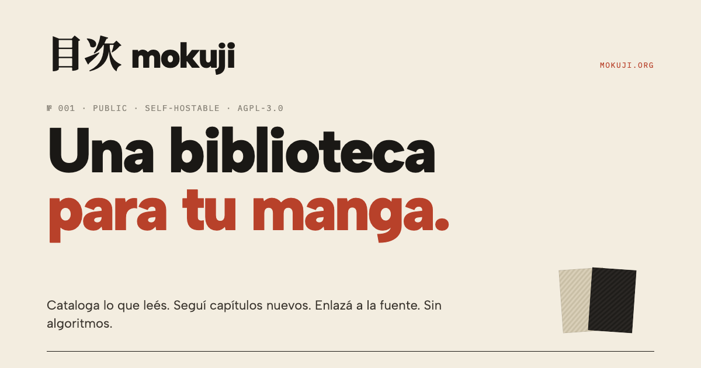

  

# mokuji

> Una biblioteca pública y self-hostable para tu manga. Cataloga, sigue
> capítulos nuevos, enlaza a la fuente. Sin algoritmos.

🏠 Instancia pública: **[mokuji.org](https://mokuji.org)**
📖 Código: **[git.odin.do/kengru/mokuji](https://git.odin.do/kengru/mokuji)**

<!--
TODO(v1.0): screenshot. Capturar de mokuji.org una vista de la biblioteca
poblada (dark mode preferible). 1600×1000 aprox, exportar a /docs/screenshot.png
y descomentar la línea de abajo.

-->

## Qué hace

- **Biblioteca privada**. Cataloga manga con estado (leyendo / por leer /
  completado), favoritos, y exporta a JSON cuando quieras.
- **Releases multi-source**. Matchea automáticamente contra **MangaDex**,
  **Asura Scans** y **Comick**. Cuando hay capítulo nuevo aparece en
  `/releases` con link directo al reader.
- **Digest por email opt-in**. Semanal por default (domingos), diario si lo
  pides, o apagado. Nunca predatory, sin "engagement tricks".
- **Perfil público opcional**. En `/u/{handle}` si decides hacerlo visible;
  privado por default.

## Stack

Go (stdlib `net/http`) + SQLite (vía `modernc.org/sqlite`, sin CGO) +
`html/template` server-rendered + vanilla JS. Un solo binario estático
~13 MB. Email outbound vía SMTP. PWA instalable. Sin Docker requerido,
sin base de datos externa, sin Redis, sin Node. Detalle por capa en
[`docs/adr/`](docs/adr/).

## Sources

| Source | Estado | Notas |
|--------|--------|-------|
| [MangaDex](https://mangadex.org) | siempre on | API pública oficial. |
| [Asura Scans](https://asurascans.com) | opt-in default on | Scanlation. Apaga con `ASURA_ENABLED=false`. |
| [Comick](https://comick.io) | opt-in default on | Usa el subdominio API sin Cloudflare. Apaga con `COMICK_ENABLED=false`. |

Bato.to y otros están en el backlog post-v1.0.

## Empezar a contribuir o self-hostear

- **Self-hosting**: [`docs/self-hosting.md`](docs/self-hosting.md). Cubre
  build, env vars, principios de deploy (sin atarse a una plataforma) y
  troubleshooting.
- **Contribuir**: [`CONTRIBUTING.md`](CONTRIBUTING.md). Setup local,
  convenciones de commits, cuándo ADR, flow de PRs, voz.
- **Decisiones arquitectónicas**: [`docs/adr/`](docs/adr/). Una ADR por
  decisión cerrada. Si quieres entender el porqué de algo, está ahí.
- **Estado del proyecto**: [`docs/estado.md`](docs/estado.md). Snapshot
  de qué corre, qué falta, gotchas operativos.

## Filosofía

- **File over App** — el código y los datos deben sobrevivir cualquier
  herramienta.
- **Texto plano y formatos abiertos** cuando sea posible.
- **Self-hosted donde aporta valor**, comercial donde es claramente mejor.
- **Mínimo viable**, expandir solo cuando duela un problema real.
- **Sin lock-in** de plataforma ni de proveedor.
- **Comprensión sobre conveniencia** — las primitivas de seguridad y core
  se entienden a fondo antes de usarse, idealmente leyéndose en menos de
  100 líneas. Por eso CSRF, sessions y migrations son código propio
  chiquito en vez de librerías.

## Licencia

[AGPL-3.0](LICENSE).

Si corres mokuji para ti o tu grupo, puedes hacer lo que quieras con el
código. Si lo corres como **servicio público** para otros users (al estilo
de mokuji.org), debes ofrecer el código fuente —incluyendo tus
modificaciones— a esos users. Esto es lo que distingue AGPL de GPL: cubre
el caso del software como servicio.

Para reportar vulnerabilidades, mira [SECURITY.md](SECURITY.md).
